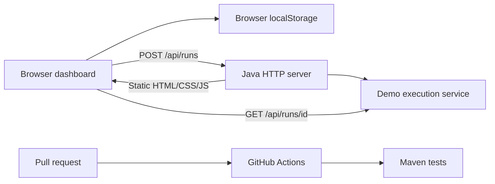
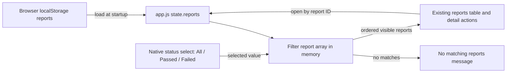
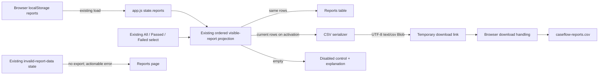
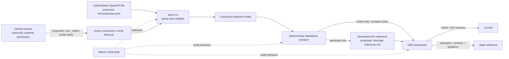
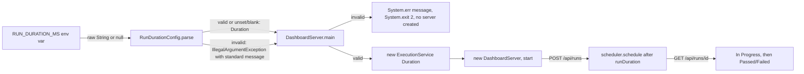
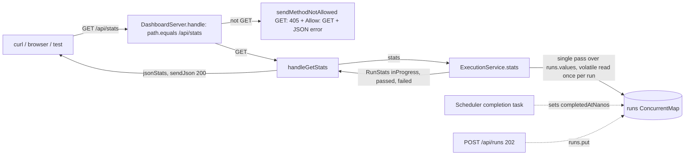

# Architecture

## Overview

The capstone has a dependency-free Java 17 HTTP server, a browser-based dashboard, and a deliberately simulated test runner. The browser stores test cases and report history in local storage. The Java server only serves the app and simulates asynchronous run status.



## Components

| Component | Responsibility |
|---|---|
| `DashboardServer` | Serves the UI assets and exposes health and demo-run endpoints using the JDK HTTP server. |
| `ExecutionService` | Creates in-progress run records, then completes them as Passed or Failed after a short scheduled delay. |
| `static/index.html` | Dashboard layout, login gate, test-case form, reports and confirmation dialogs. |
| `static/app.js` | Local storage, create/read/update/delete, search/filter, runner polling, and report history. |
| `static/styles.css` | Responsive dashboard styling and status indicators. |
| `src/test/java` | JUnit tests for execution transitions and HTTP endpoint behavior. |
| `.github/workflows/ci.yml` | Runs the Maven test suite on pull requests and pushes to `main`. |

## Data flow

1. The dashboard starts with a demo login gate. No credential validation or session security is provided.
2. Cases are loaded from local storage, or a few sample cases are shown on first use.
3. Create/edit/delete operations update browser storage and rerender the table. Deletion requires explicit confirmation.
4. On Run Test, the browser creates a local In Progress state and submits the case ID, name, and selected demo outcome to the Java server.
5. The Java runner returns a run ID. The browser polls for completion, updates the case's last result, and saves a report locally.
6. The reports page displays status, time, duration, and simulated failure details.

## US-103: Client-side report status filter

The status filter is a view over the reports already loaded into `state.reports`; it does not introduce another data store, API, or report lifecycle. This keeps US-102's browser-local report ownership and simulated-run boundary unchanged.



| Existing component / interface | US-103 responsibility |
|---|---|
| `static/index.html` reports page | Provide a visibly labeled native select with All, Passed, and Failed options. All is its default option; retain the existing reports table container and add a polite live region for the result count and no-match announcement. |
| `static/app.js` report state and renderer | Validate the loaded report value is an array before rendering. On selection change, filter `state.reports` in memory and render the resulting projection. Use `Array.filter` so the stored report order is retained. Keep report-detail actions keyed to the original report IDs in `state.reports`. |
| `static/styles.css` | Reuse the current `.filters select` form-control treatment and `.empty-state` visual pattern; no new styling system is required. |
| Browser `localStorage` | Remains the source of the full report list. The filter neither writes nor deletes report data. |

### Filter flow, behavior, and boundaries

At startup, `app.js` loads reports from local storage as it does today. The select starts at All and a render shows every report in existing order. A selection change calls the client-side report renderer without reloading the page; All uses the complete array, while Passed or Failed produces an in-memory filtered array. The displayed count represents the visible rows. Opening a report continues to resolve its ID against the full report collection, so filtering does not impair report details.

An empty stored report list keeps the existing “No execution reports yet” state. If reports exist but none match the selected status, show a distinct, clear “No matching reports” empty state. A no-match result is normal filter behavior, not a storage or runner error; changing the selection can reveal the reports again. The native select provides standard keyboard operation and the visible label explains its purpose.

After a filter change, update a polite live region with the visible result count or the no-match message without moving focus. If the stored report value parses as valid JSON but is not an array, do not call array methods on it or replace/delete it; show an actionable report-data error instead. This error is distinct from both empty states.

Filter selection is transient UI state only: do not add it to local/session storage or the report data model. It starts at All after a full page reload. In-page navigation may retain the current select value while the document remains loaded. Filtering issues no HTTP request and does not change run generation, report retention, or server responsibilities.

### Security, error handling, and testability

The browser processes only reports already available locally; no report data or selected status is sent to the Java server. Render report fields through the existing HTML-escaping helpers and retain existing storage read-error handling. Filtering must not mutate `state.reports` or call report persistence. The no-match state is separate from the existing storage-error toast behavior.

The behavior is deterministic for a given report array and selected status. Verify All/default and reload, each status subset, stable relative order, report-detail actions, no-match versus no-reports messaging, polite result announcements, unchanged stored report data, and the non-destructive invalid-data error state using a documented browser acceptance checklist. Run `mvn test` for existing Java regressions. The repository has no browser JavaScript test harness; this feature does not add test tooling or dependencies, so manual browser evidence is required for client behavior.

### Acceptance-criteria trace

| Criterion | Architectural path |
|---|---|
| AC-06 | Native labeled All/Passed/Failed select; All is the initial value and renders the full report array. |
| AC-07 | Change event filters in the browser, preserves input order, and leaves each row's report-detail action available. |
| AC-08 | Filter acts only on a derived in-memory view; it does not write/delete reports, and a document reload initializes the select to All. |
| AC-09 | An existing report list with zero matches renders the explicit no-matching-reports state, distinct from the no-reports-yet state. |
| AC-10 | A polite live region announces the visible result count or no-match state without moving focus. |
| AC-11 | A valid-JSON, non-array report value produces an actionable error without a rendering crash or change to stored data. |

**Approved decisions and trade-offs:** The two completed statuses remain Passed and Failed as specified; All includes every report currently loaded. A native select and an in-memory projection favor accessibility and minimal change over custom filter controls or cached derived state. The projection is transient, so a reload intentionally loses the selection. A polite live region supplements the native select so result changes are announced. Structurally invalid report data is reported without destructive repair. Because the repository has no browser test harness, use a documented manual browser checklist plus `mvn test` rather than adding test dependencies for this feature.

## US-104: Client-side export of visible reports as CSV

**Source and approval:** This architecture is based on the approved US-104 requirements in `requirements.md`, whose source is the user-provided chat story. No Jira or MCP retrieval is claimed. The approved requirements fix the fields, raw values, filename, empty-state behavior, and no-transfer/no-mutation boundary described below.

US-104 extends the existing Reports page without changing report creation, storage, filtering, report-detail actions, or the Java runner. The export uses the same ordered in-memory visible-report projection that supplies the table. All, Passed, and Failed therefore export exactly the rows currently visible, in their current order, without a second independent filter or a new storage read.



| Component / interface | US-104 responsibility |
|---|---|
| `static/index.html` Reports page | Add an Export CSV button beside the existing filter and a visible explanation when no reports are visible. Preserve the existing status filter, table, detail actions, and live region. Use the existing native control and accessibility patterns. |
| `static/app.js` visible-report projection | Derive the ordered visible rows from `state.reports` and the current filter for both table rendering and export. Update disabled state and explanation whenever the projection changes. |
| `static/app.js` CSV serializer | Map each visible report's `caseId`, `title`, `status`, `durationMs`, `timestamp`, and `failureDetails` into the exact required column order; preserve the raw integer duration and stored ISO-8601 timestamp. Serialize CSV quoting without mutating report values. |
| `static/app.js` download lifecycle | Build UTF-8 CSV content as a browser `Blob`, use a temporary object URL and download link with the exact filename, initiate the browser download, then release temporary resources. Do not make a network request. |
| `static/styles.css` | Reuse the existing button, filter, disabled-control, empty-state, and text styles where practical; no styling framework or dependency is added. |
| Browser | Provide Blob, object-URL, and anchor-download behavior and handle the user's local download destination. The dashboard does not control that destination or receive a reliable completion signal. |

### Data flow, CSV contract, and interface

The existing page loads reports from local storage into `state.reports`. The existing All/Passed/Failed selection is applied in memory; its ordered projection drives both the table and export availability. A filter change rerenders the table and updates the control from that projection. On activation, the serializer obtains the projection for the current filter and serializes those rows only. The All filter includes every report; Passed and Failed include only matching reports. The filter remains transient as specified by US-103.

The CSV contract is exactly six columns, in this order: `Case ID`, `Test Case`, `Status`, `Duration (ms)`, `Executed At`, `Failure Details`. Emit exactly one header record followed by one data record for each visible report. Map the corresponding stored report fields as follows:

| CSV column | Report value |
|---|---|
| `Case ID` | `caseId` |
| `Test Case` | `title` |
| `Status` | `status` |
| `Duration (ms)` | `durationMs` as the underlying integer milliseconds, not the humanized display string |
| `Executed At` | `timestamp` as the stored ISO-8601 value, not the locale-formatted display string |
| `Failure Details` | `failureDetails` |

For CSV field encoding, quote any field containing a comma, a double quote, or a line break (CR or LF); within a quoted field, represent each embedded double quote as two double quotes. This is the CSV escaping needed for a reader to recover the original field value, including embedded line breaks. Do not replace or normalize a field's contents as part of CSV escaping. Encode as UTF-8 and set the download name exactly to `caseflow-reports.csv`. CRLF between CSV records is a conventional implementation choice; line breaks inside values remain part of their fields and are escaped/quoted as above.

### Empty state, errors, and download lifecycle

When the visible projection is empty—either there are no reports or the current status has no matches—disable Export CSV and show a nearby visible, understandable explanation such as “No visible reports to export.” Do not create a header-only file. Continue to distinguish these empty states in the table as US-103 specifies. If the stored report value is invalid under the existing US-103 handling, retain the actionable invalid-data error, do not export an empty fallback, and do not alter the stored value; the export control must not imply that invalid data is a valid empty report list.

On successful serialization, create a UTF-8 CSV `Blob`, create a temporary object URL, and activate a temporary download link carrying the required filename. Release the object URL and temporary link after activation using browser-compatible cleanup timing. A synchronous serialization/Blob/object-URL failure leaves report state untouched and is surfaced through the existing actionable toast/error pattern. The browser does not reliably report that a user completed or accepted the download; browser-managed download outcomes are outside the dashboard's control.

### Security, privacy, and operational boundaries

Export executes entirely in the current browser from reports already loaded in memory. It does not write to local storage, change `state.reports`, change the selected filter, update report history, issue `fetch`/XHR, or add a server endpoint. The only output is the user's normal browser download. There is no new runtime/build dependency, Java-server responsibility, database, external service, or telemetry. The app's demo login is not access control; exported reports remain ordinary local demo data and are not protected from other users of the browser profile.

CSV quoting ensures field boundaries and round-trip fidelity; it does not prevent spreadsheet applications from interpreting formula-like text as formulas. The exact-value requirement means silently prefixing, escaping beyond CSV syntax, or otherwise changing such values is not part of this design. Preserve the original value and record formula interpretation as a residual spreadsheet risk. Safe spreadsheet transformation would require a separately agreed mode or changed fidelity requirement and is not included here.

### Testability, trade-offs, and acceptance trace

The serializer is deterministic for a given ordered report projection. Verify it with commas, double quotes, CR/LF, Unicode, empty failure details, and values combining multiple special characters; parse the result with a CSV reader and confirm that the original values and exact six-column header are recovered. Browser acceptance evidence should check the All/Passed/Failed subsets against the actual visible rows, order, exact raw duration and timestamp, filename, empty-list and no-match disabled/explanation states, invalid-data non-destructive handling, local download behavior, and unchanged local storage/report state. The repository has no browser JavaScript test harness, so this architecture adds none; existing Maven Java tests do not directly exercise client-side CSV. No tests have been run in this architecture phase.

| Criterion | Architectural path |
|---|---|
| AC-12 — Export action | Add an Export CSV control to the existing Reports page. |
| AC-13 — Export the visible subset | Use only the ordered in-memory projection shared with the table; All, Passed, and Failed therefore yield the currently visible rows at activation. |
| AC-14 — CSV columns and values | Emit the six exact header labels in order and map the specified report fields; use integer `durationMs` and stored ISO-8601 `timestamp`, not display formatting. |
| AC-15 — Header and order | Emit one header record, then data records in the same order as the visible projection/table. |
| AC-16 — UTF-8 CSV escaping | Encode as UTF-8 and quote fields containing commas, quotes, or line breaks; double embedded quotes so CSV parsing recovers original field values. |
| AC-17 — No visible reports | Disable export and explain there are no visible reports, both for an empty report list and a no-match filter result. |
| AC-18 — Filename | Set the browser download filename exactly to `caseflow-reports.csv`. |
| AC-19 — Read-only local export | Perform serialization and download in the browser without changing saved reports or transmitting report data to the server. |

**Assumptions and trade-offs:** The Java 17 / Maven / plain HTML-CSS-JavaScript stack and current browser-local report ownership remain unchanged. Sharing the current projection favors parity and minimal surface area over a new export query/service. CRLF is a conventional CSV record separator; the requirement does not otherwise mandate a record delimiter. Exact-value fidelity is preserved at the cost of the noted spreadsheet formula interpretation risk. No implementation, new dependency, server endpoint, persistence change, or change to approved requirements is proposed.

## API

- `GET /api/health` — returns server status.
- `POST /api/runs` — form-encoded case ID, title, and requested demo outcome; creates a run and returns its ID.
- `GET /api/runs/{id}` — returns In Progress or the final Passed/Failed status, duration, timestamp, and failure message.
- `GET /api/stats` — returns server-wide counts of started runs: `{"totalRuns":N,"inProgress":N,"passed":N,"failed":N}` (US-106).

## Security and operational boundaries

- The login is a UI demonstration only and must not be used to protect real data.
- The app uses no real secrets and makes no external network requests.
- Java validates the run outcome and limits the request body size. Browser-rendered user text is HTML-escaped.
- Case data and reports are not sent to the server for storage.
- The simulated result is not evidence that a real UI test passed. The optional outcome selector exists only to demonstrate both result states.

## Agentic SDLC customization

Workspace instructions give Copilot the project rules. `SDLC Orchestrator` guides eight sequential phases and delegates to a requirements, architecture, design-review, planning, implementation, code-review, verification, or PR-preparation specialist. Each phase specialist links to its matching prompt and skill. The dashboard review agent remains a focused read-only reviewer for US-102.

No lifecycle hook is installed because hidden automatic execution is unnecessary. Human approval gates control transition between phases and all publishing actions; Maven and CI provide explicit deterministic verification.

## DOCSYNC-1: Generate and check the API reference from OpenAPI

This is a separate repository-documentation capability. It does not change the dashboard API, server behavior, or the preceding US-102 through US-104 designs. The repository currently has no OpenAPI definition or API-reference file in the inspected `docs/` or `automated-api-documentation-sync/` locations, and no existing OpenAPI generator or documentation-sync convention was found. Consequently, source/output paths and CI integration below are **proposed assumptions**, not confirmed repository facts or user decisions.

### Repository fit and proposed components

The project already uses Java 17, Maven, JUnit 5, and a read-only GitHub Actions workflow that runs `mvn --batch-mode verify`. A small Java command-line utility tested with JUnit is the closest fit to those conventions and avoids establishing an unrelated runtime or toolchain. The existing Maven dependencies do not include an OpenAPI parser, so robust OpenAPI parsing/validation would require an explicitly version-pinned parser dependency; its exact library and version are implementation choices to confirm, not existing project capabilities.

**Proposed path defaults (not confirmed):** use `docs/openapi.yaml` as the authoritative source and `docs/api-reference.md` as the generated artifact. The input must be supplied/approved independently: creating or changing the OpenAPI definition is explicitly outside DOCSYNC-1. If no authoritative definition is made available, the generator/check cannot complete successfully and CI integration cannot yet be made green.



| Component | Responsibility and interface |
|---|---|
| OpenAPI source | Supplies the single authoritative definition. Its actual path, format (YAML/JSON), version, and ownership have not been confirmed. |
| `ApiReferenceTool` (proposed Java CLI) | Exposes separate `generate` and `check` modes. Accepts explicit input/output paths or uses agreed defaults; returns a success/non-success process exit code and actionable diagnostics. The command shape and class/package are not established conventions yet. |
| Parser/validator | Parses the OpenAPI document and validates it before rendering. Exposes only endpoint path, HTTP method, and summary to the renderer; unrelated schema details are not emitted. A missing summary on an operation should be treated as an actionable validation error rather than silently fabricated (assumption needed because OpenAPI can permit omitted summaries while DOCSYNC-AC-01 requires one). |
| Canonical endpoint model and renderer | Produces a clearly labeled Markdown API-reference section from every parsed operation. Sort paths lexicographically and methods in a fixed order, use stable escaping/formatting, UTF-8 and LF line endings, and exclude timestamps or environment-specific values so equivalent input always renders identical bytes. |
| Reference target | A dedicated generated file, proposed as `docs/api-reference.md`, rather than a generated region mixed into manually maintained docs. Updating that one target leaves all other documentation untouched. |
| Drift check | Renders in memory and byte-compares the result with the checked-in target. It reports a current reference on equality and a stale/missing reference on mismatch, with the exact regeneration guidance. It does not write output, temporary files, or repository state. |
| Maven/JUnit and GitHub Actions | Unit/integration tests exercise the utility with temporary fixtures. Proposed CI integration makes the read-only check part of the existing `verify` lifecycle while retaining the current workflow command and its `contents: read` permission. This integration is a recommendation, not an existing configured behavior. |

### Data flow, interfaces, and operations

For either mode, the utility reads the selected OpenAPI source, parses and validates it, constructs a canonical endpoint list, and renders the complete output in memory. Rendering includes every operation's path, method, and summary, with an explicit generated-reference heading/marker. Paths and methods are ordered independently of parser/map iteration so the output is repeatable. Method labels use a documented consistent case; Markdown-special characters in summaries are escaped without losing their meaning as displayed text.

In `generate` mode, write only the generated reference target after parsing, validation, and rendering all succeed. To avoid truncating a valid prior reference on an I/O failure, write to a temporary file in the target directory and replace the target only after the completed output is ready. This is a write to the generated target only; never rewrite or clean up unrelated docs. If the generated bytes equal existing bytes, generation may leave the file untouched. Atomic replacement behavior depends on filesystem support and should have a safe fallback that does not delete the old reference before replacement succeeds.

In `check` mode, perform no writes at all—including no temporary files—and compare rendered bytes directly with the checked-in reference. A mismatch (including a missing output target) is stale, yields a nonzero exit status, and prints the approved regeneration command. Equality yields success. The check must not invoke generation mode, stage files, commit, push, or use credentials. A missing or invalid source fails before either comparison or update and provides a path/validation-specific explanation; in generation mode an existing reference remains byte-for-byte unchanged.

**Proposed invocation/integration assumption:** define a Maven-executable `check` entry point attached to `verify`, so the existing CI workflow's `mvn --batch-mode verify` automatically performs the read-only drift check. Document a corresponding explicit local `generate` invocation as the regeneration instruction printed by stale checks. The current POM's `exec-maven-plugin` is already configured for the dashboard server, but there is no documentation-tool execution or command; how the utility is launched (dedicated plugin execution, plugin goal, or another Maven wrapper) remains a design/implementation decision. CI's current read-only repository permission is a suitable boundary; no write token or publishing step is needed.

### Security, error handling, testability, and boundaries

Treat the OpenAPI file as repository input: parse it as data, do not execute content, resolve external references over the network, or include secrets. Network resolution should be disabled unless later explicitly required and reviewed. Diagnostics should identify the source path and actionable parse/validation issue without dumping environment variables or unrelated document contents. The utility needs no server endpoint, database, external service, commit/push capability, or CI write permission.

Validation and rendering must complete before a generation write is attempted. Missing input, malformed/unsupported OpenAPI input, missing required operation summary, and read/write failures produce a nonzero result and concise corrective guidance. In every source parse/validation failure, preserve any existing output. A stale check is an expected failure state, distinct from an invalid-input/tool failure, but both must fail CI so stale or unprocessable documentation cannot pass silently.

Use the established Maven/JUnit 5 test stack and isolated temporary directories/fixtures; do not make test runs depend on repository mutation or network access. The DOCSYNC-AC-07 suite should test:

- valid definitions with multiple paths and methods generate a clearly labeled reference containing every path, method, and summary;
- repeated generation from unchanged input yields byte-for-byte identical output, including stable ordering and line endings;
- a deliberately changed expected reference is detected as stale, reports regeneration guidance, and remains unchanged after check;
- missing and invalid source inputs report actionable failures and preserve a pre-existing reference byte-for-byte;
- successful update changes only the designated target, leaving neighboring/manual documentation unchanged.

The final item directly verifies the DOCSYNC-AC-06 boundary in addition to the four required test categories. Avoid adding unrelated endpoints, schema prose, API behavior changes, automated publishing, or documentation cleanup. No implementation or tests have been run as part of this architecture phase.

### Acceptance-criteria trace

| Requirement | Architectural path |
|---|---|
| DOCSYNC-AC-01 — Generate endpoint reference | Parse all OpenAPI operations; render each path, method, and summary in one clearly identified generated reference. An operation with no summary is an actionable validation issue rather than fabricated content. |
| DOCSYNC-AC-02 — Deterministic output | Canonical path/method ordering, stable escaping/template, UTF-8/LF, and no timestamps/environment data; assert byte-for-byte repeat generation in tests. |
| DOCSYNC-AC-03 — Stale check guidance | In-memory rendering and byte comparison; mismatch or missing target returns nonzero and prints the agreed regeneration command. |
| DOCSYNC-AC-04 — Read-only check | Dedicated check path only reads input/target and compares in memory; no temp files, writes, commits, pushes, or credentials. Verify the target and surrounding files remain unchanged in tests. |
| DOCSYNC-AC-05 — Safe input errors | Parse/validate before writing; missing/invalid input returns a path-specific actionable diagnostic and cannot overwrite the existing target. |
| DOCSYNC-AC-06 — Preserve other documentation | Write a dedicated generated artifact only; test that updating it leaves other docs unchanged. |
| DOCSYNC-AC-07 — Required test coverage | JUnit tests cover successful generation, deterministic unchanged output, stale detection, missing input, and invalid input; add a preservation check for unrelated docs. |

### Assumptions, trade-offs, uncertainty, and scope

- **Path assumptions only:** `docs/openapi.yaml` and `docs/api-reference.md` are proposed defaults, not confirmed source/output locations. The source definition itself was not found and its creation is out of scope.
- **CI assumption only:** attaching the read-only check to Maven `verify` is recommended because that is the existing CI entry point; no workflow change has been made. This check will need an authoritative OpenAPI input before it can pass in CI.
- **Format/tool assumption:** Markdown and a Java-compatible OpenAPI parser fit the existing documentation/build ecosystem, at the cost of a new parser dependency and maintenance. Exact output format and parser/version remain for approval.
- **Validation assumption:** each endpoint operation needs a summary to satisfy the requirement; report missing summaries rather than infer one.
- **Isolation trade-off:** a standalone generated file is less seamless than inserting a generated block into an existing API guide, but strongly reduces the risk of altering manually authored documentation.
- **In scope:** generator/check behavior, deterministic rendering, safe target update, read-only drift reporting, tests, and proposed CI integration.
- **Out of scope:** creating or changing the authoritative OpenAPI definition; changing API implementation; unrelated documentation generation; auto-commits, pushes, or deployments.
- **Unresolved before implementation:** confirm authoritative source path/definition and version, reference destination and format, and whether the proposed Maven `verify` integration/command is desired. “Go forward” authorizes this architecture draft with assumptions; it does not resolve these decisions or establish Jira/MCP provenance.

**Approval request:** Please review the DOCSYNC-1 architecture and confirm or revise the proposed source/output paths, Markdown format, and read-only Maven `verify` integration. I am pausing here for human approval; design review has not started.

## US-105: Configure the simulated test run duration

**Source and approval:** Based on the user-approved US-105 section of `requirements.md` (FR-12, AC-20 through AC-25). This is a backend startup-configuration change only. It does not change the browser UI, `/api/health`, `/api/runs`, `/api/runs/{id}`, the report format, `PORT`/port-argument handling, or the simulated nature of runs, and it adds no dependency. Code facts below come from inspecting `DashboardServer.java`, `ExecutionService.java`, `ExecutionServiceTest.java`, and `README.md`.

### Current state and key constraint

`DashboardServer.main` parses the port (argument 0, else `PORT`, default 8080), then runs `new DashboardServer(port, new ExecutionService())` and `start()`. `ExecutionService()` hard-codes `Duration.ofMillis(1400)`, and a package-private `ExecutionService(Duration)` constructor already exists and is used by tests. Note that the `DashboardServer` constructor calls `HttpServer.create(new InetSocketAddress(port), 0)`, which binds the port, not just `start()`. "Before the server listens" therefore means validation must run **before `new DashboardServer(...)`**, not merely before `start()`.



### Components touched

| Component | US-105 responsibility |
|---|---|
| `RunDurationConfig` (new, package-private final class in `org.example.dashboard`) | Pure parsing and validation. Exposes `static Duration parse(String raw)` and the constant message `RUN_DURATION_MS must be a whole number from 100 to 10000.` It does not read the environment, print, or exit, so unit tests need no server and no `System.exit`. |
| `ExecutionService` | Unchanged run logic. Introduce a package-private `static final Duration DEFAULT_RUN_DURATION = Duration.ofMillis(1400)` and have the public no-arg constructor delegate to it, so 1400 has a single source of truth shared with the parser. The existing package-private `ExecutionService(Duration)` constructor is the injection point; it is reachable from `DashboardServer.main` because both classes share the package, so it need not become public. Add a package-private read-only accessor `Duration runDuration()` (design-review decision D1) so tests can assert the AC-20 default, the no-arg-constructor delegation, and the parsed value deterministically; it has no effect on run behavior. |
| `DashboardServer.main` | Only place that reads `System.getenv("RUN_DURATION_MS")`, calls the parser, and on failure writes to stderr and exits. Passes the resulting `Duration` to `new ExecutionService(duration)`. The `DashboardServer` constructor, `start()`, handlers, and API are untouched. |
| `README.md` | Add a `RUN_DURATION_MS` note directly beside the existing `PORT` sentence (line 36): unit (ms), default 1400, valid range 100-10000 whole numbers, that an invalid value stops startup with an error, a concrete example such as `RUN_DURATION_MS=500 mvn exec:java`, and a caution that reloading or closing the page during a run leaves that case showing "In Progress" (existing behavior, made more likely by longer durations; recovery is a separate follow-up story, decision D4) (AC-25). |
| `src/test/java` | New `RunDurationConfigTest`; additions to `ExecutionServiceTest`; new `StartupConfigurationTest` holding the two subprocess startup tests (decision D2, below). |

### Parsing and validation unit (`RunDurationConfig.parse`)

Input is `String raw` (possibly `null`). Output is a `Duration` or an `IllegalArgumentException` whose message is exactly the standard message. Rules, applied in order:

1. `null` returns `DEFAULT_RUN_DURATION`.
2. `s = raw.strip()`. If `s` is empty (so empty and whitespace-only inputs) return `DEFAULT_RUN_DURATION`. `strip()` is used rather than `trim()` so "blank" matches `String.isBlank()` Unicode whitespace semantics (confirmed decision D3; the requirements now say "stripped"). A value surrounded by an EM SPACE (U+2003) is accepted; a non-breaking space (U+00A0) is not whitespace under `strip()`, so it remains and causes rejection, as does a zero-width space.
3. Reject unless `s.length()` is 3 to 5 and every character is an ASCII digit `'0'..'9'`. Do not use `Character.isDigit`, which accepts non-ASCII Unicode digits that `Integer.parseInt` would also accept. This rejects signs, decimals, `1e3`, text, and embedded whitespace.
4. Reject if `s.charAt(0) == '0'` (leading zeros such as `0100`). With no leading zero, a 3-digit value is automatically at least 100.
5. `Integer.parseInt(s)` is now provably safe: at most 5 ASCII digits cannot overflow `int`, so no `NumberFormatException` can occur. Values such as `99999999999` fail at the length check and never reach parsing. Reject if the value is greater than 10000.
6. Return `Duration.ofMillis(value)`.

All rejection paths throw the same exception type and the same message; the invalid input is deliberately not echoed. The method has no side effects and no timing dependence, so it is fully deterministic.

### Where validation and exit happen, and how the error reaches stderr

In `main`, after the existing (unchanged) port parse and before any `DashboardServer` or `ExecutionService` is constructed:

```
Duration runDuration;
try {
    runDuration = RunDurationConfig.parse(System.getenv("RUN_DURATION_MS"));
} catch (IllegalArgumentException error) {
    System.err.println(error.getMessage());
    System.exit(2);
    return;
}
```

- The message goes to `System.err` through `println`, satisfying the "shown to the person starting the server" assumption and keeping stdout for the existing "running at" line. The catch wraps only the parser call, so unrelated failures are not mislabeled.
- Exit code 2 is a design choice (any non-zero value satisfies AC-22). It differs from the JVM's code 1 for an uncaught exception, so a configuration error is distinguishable.
- `System.exit` appears only in `main`. At that point nothing has been bound or scheduled: no `HttpServer`, no `ExecutionService` scheduler thread, and no shutdown hook, so exit is clean and the server never listens.
- Because the check sits after port selection, it applies identically whether the port came from the CLI argument or `PORT` (the earlier assumption). Existing port parsing is left exactly as is, including its current behavior on a malformed port. Only the numeric parse of the port (`Integer.parseInt`) precedes duration validation: if the port is non-numeric and `RUN_DURATION_MS` is also invalid, the existing port `NumberFormatException` happens first. An out-of-range port (`new InetSocketAddress`) or an in-use port (`HttpServer.create`) fails inside `new DashboardServer(...)`, after duration validation, so an invalid duration is reported first in those cases (and the subprocess ordering test below relies on this). This ordering keeps port behavior unchanged and is recorded as a decision.
- The value is read once at startup and the `Duration` is stored in the final field `ExecutionService.runDuration`, so it cannot change while the server runs.

### Data flow

1. The operator starts the JVM, optionally with `RUN_DURATION_MS` set (and a port argument or `PORT`).
2. `main` resolves the port as before, then reads `RUN_DURATION_MS` and calls `RunDurationConfig.parse`.
3. Invalid: print the standard message to stderr, exit 2. No bind, no threads.
4. Valid, unset, or blank: `new ExecutionService(duration)` then `new DashboardServer(port, service)` then `start()`; the "running at" line is printed as before.
5. For each `POST /api/runs`, `ExecutionService.start` records the run as In Progress and schedules completion after `runDuration.toMillis()`. `GET /api/runs/{id}` reports In Progress until the scheduled task sets `completedAtNanos`, then Passed or Failed with `durationMs` measured from run start to completion. Request/response shapes are unchanged.

### Testability, including AC-23

**AC-24 unit tests (`RunDurationConfigTest`, plain JUnit 5, no server, no `System.exit`):**

| Group | Inputs | Expected |
|---|---|---|
| Default | `null`, `""`, `"   "`, tab/newline-only | 1400 ms |
| Boundaries and strip | `"100"`, `"10000"`, `" 500 "`, `"200"`, `" 500 "` (EM SPACE) | 100, 10000, 500, 200, 500 ms |
| Rejected | `"99"`, `"10001"`, `"0"`, `"0100"`, `"+100"`, `"-5"`, `"100.5"`, `"1e3"`, `"abc"`, `"1 000"`, `"99999999999"`, `"2147483648"`, a very long digit string, a non-ASCII digit string, `" 500"` / `"500 "` (NBSP) | `IllegalArgumentException` with exactly the standard message (assert no other exception type) |

Write non-ASCII inputs with `\u` escapes. Assert the message against the **literal** text `RUN_DURATION_MS must be a whole number from 100 to 10000.`, not the `RunDurationConfig` constant, so an accidental edit of the message is caught (design-review F10). Also assert `parse(null)` equals `ExecutionService.DEFAULT_RUN_DURATION` and is 1400 ms.

Parameterized tests are fine only if no new dependency is needed; the repository's existing JUnit setup should be checked at implementation time. A loop over an array within plain `@Test` methods avoids the question.

**Deterministic configuration checks (`ExecutionServiceTest`, decision D1):** using the package-private `runDuration()` accessor, assert `new ExecutionService().runDuration()` equals `Duration.ofMillis(1400)` (AC-20 and the no-arg delegation) and `new ExecutionService(RunDurationConfig.parse("200")).runDuration()` equals `Duration.ofMillis(200)` (parser-to-service wiring). These involve no timing and cannot flake.

**AC-23 timing smoke test with tolerance (`ExecutionServiceTest`):** construct `new ExecutionService(RunDurationConfig.parse("200"))`, call `start`, and:

- assert the returned status is `In Progress` immediately (this is the deterministic In Progress check; no separate "about 50 ms later" assertion is required, and if one is kept it must be conditional on a measured elapsed time below about 150 ms);
- poll `find(id)` every ~10 ms with a generous overall deadline (for example 3 s) rather than a single fixed `sleep`, to avoid the flakiness in the existing sleep-based tests;
- once the status is Passed or Failed, assert `durationMs` is **at least 200** and **below 1000 ms**.

The lower bound is exact and reliable: the run's start nanotime is captured before the schedule call and a `ScheduledThreadPoolExecutor` never fires early, so elapsed time is at least 200 ms and the truncated millisecond value is at least 200 (no truncation tolerance is needed). The 1000 ms upper bound leaves 800 ms of scheduler/CI jitter headroom and is clearly below the 1400 ms default, so the smoke test fails if a default-length run is observed. It is the only timing-sensitive assertion; no assertion depends on exact equality (per the requirements' tolerance note). The earlier draft's 1500 ms upper bound was above the 1400 ms default and could not distinguish the two, so it was corrected (design-review US105-F1). The test uses the service-reported duration, so it does not depend on `Thread.sleep` accuracy for correctness.

**Startup behavior (two subprocess tests, decision D2; own class `StartupConfigurationTest`):** because `System.exit` lives only in `main`, AC-21 to AC-23 end to end are checked by launching the real `main` in a child JVM. No new dependency is needed. Both tests follow these conditions:

- locate the classes from `DashboardServer.class.getProtectionDomain().getCodeSource()`, not a relative `target/classes`, and launch `java.home/bin/java` with `-cp` that location;
- pass the port as an explicit argument (so `PORT` is never read) and set or remove `RUN_DURATION_MS` explicitly in `ProcessBuilder.environment()`;
- send child output to temp files (or drain it), use `waitFor(timeout)` (about 20-30 s) and `destroyForcibly()` in a `finally`, with a JUnit `@Timeout` as a second guard, because a regression that lets the child start would never exit;
- assert the message as a trimmed stderr line equal to the literal standard message (not whole-stream equality, since `JAVA_TOOL_OPTIONS` may add a line, and not the platform line separator).

1. **Invalid value with an occupied port (AC-22 ordering).** The test opens and holds a `ServerSocket(0)`, starts the child with that port and `RUN_DURATION_MS=abc`, and asserts: exit code 2, the exact message on stderr, no `BindException` or stack trace on stderr, and no "running at" on stdout. If validation ran after the bind, the child would fail with a bind error instead, so this proves validation precedes the bind without a "find a free port, close it, reuse it" race.
2. **Valid value, end to end (AC-21, AC-23 wiring).** The child is started with port `0` and `RUN_DURATION_MS=" 300 "`; the test reads the bound port from the "running at" stdout line (with a timeout), starts a run with `POST /api/runs`, polls `GET /api/runs/{id}` to completion, asserts the reported `durationMs` is at least 300 and below 1000 ms, then destroys the child. This also shows that the whitespace-stripped value reached `ExecutionService` through `main`.

Spawning a JVM is slower and environment-sensitive. Keeping both tests in their own class means they can be isolated or dropped if CI proves unstable (the unit tests and the deterministic accessor checks stand on their own).

**Manual verification (decision for design-review US105-F7):** because the README's main run path is `mvn exec:java`, which runs `main` inside the Maven JVM where `System.exit(2)` ends the Maven process, record at verification time the exit code and stderr of `RUN_DURATION_MS=abc mvn exec:java` and of `RUN_DURATION_MS=abc java -cp target/classes org.example.dashboard.DashboardServer 0`. This is an unverified assumption until then.

Run `mvn test` for Java regressions. No browser-side change exists, so no browser checklist is needed. No tests have been run in this architecture phase.

### Security, error handling, and boundaries

- `RUN_DURATION_MS` is operator-controlled process configuration, not remote input. No HTTP request can set or change it, and no new endpoint or field exposes it.
- Strict allow-list parsing (ASCII digits, 3-5 characters) means no exception escapes from parsing, no integer overflow, and no ambiguous numeric forms. The bounded range (100 to 10000 ms) prevents zero or negative delays and caps how long a simulated run can hold In Progress state.
- The raw value is not echoed in the error, which avoids reflecting arbitrary environment content into logs and keeps the message fixed and testable.
- No secrets, files, network calls, or persistence are involved. Runs remain simulated; the duration only shifts the scheduled completion time.
- Failure is fail-fast and explicit: invalid configuration never silently becomes the default and never produces a running server.

### Acceptance-criteria trace

| Criterion | Architectural path |
|---|---|
| AC-20 | `parse` returns `DEFAULT_RUN_DURATION` (1400 ms) for `null`, empty, or whitespace-only input; `ExecutionService()` delegates to the same constant. Covered by unit tests and by the deterministic `runDuration()` accessor check on `new ExecutionService()`. |
| AC-21 | Digits-only 3-5 char values from `100` through `10000` are accepted; `strip()` makes `" 500 "` valid as 500. Unit tests cover 100, 10000, `" 500 "`, and EM SPACE; the valid-value subprocess test covers the path through `main`. |
| AC-22 | All other inputs hit the single rejection path in `parse`; `main` prints the exact message to stderr and calls `System.exit(2)` before `new DashboardServer` binds the port; no fallback exists. The `99999999999` case is rejected by the length check before `parseInt`. Unit tests assert the literal message and exception type; the occupied-port subprocess test asserts exit code 2, stderr, no `BindException`, and no listening, which proves the ordering. |
| AC-23 | `main` passes the parsed `Duration` to `ExecutionService`, whose scheduler completes runs after that delay. Verified by the `runDuration()` accessor check, the timing smoke test (at least 200 and below 1000 ms), and the valid-value subprocess test. |
| AC-24 | New `RunDurationConfigTest` covers default (unset and blank), both boundaries, strip (including EM SPACE), and the rejected set (including NBSP). |
| AC-25 | README line beside the existing `PORT` note documents unit, default, range, failure on invalid values, a concrete example, and the stale "In Progress" caution. |

### Assumptions, trade-offs, risks, and scope

- **Separate parser class versus inline code in `main`:** a small package-private class adds one file but makes validation testable without `System.exit`, the environment, or a server. Inline code would need process-level tests for every rejected value. Chosen: separate class.
- **Parser throws versus returns a result type:** an `IllegalArgumentException` with the fixed message is the simplest fit with existing conventions (the codebase already uses it for validation). A dedicated exception or result type is more explicit but adds ceremony for one caller.
- **Manual digit scan versus `Integer.parseInt`/regex only:** the length cap makes parsing overflow-proof without relying on catching `NumberFormatException`, and avoids Unicode-digit acceptance. Slightly more code than a regex, but every rule is explicit and individually testable.
- **`strip()` versus `trim()`:** `strip()` aligns "blank" with `isBlank()` semantics, so a Unicode-whitespace-only value uses the default. A value containing other invisible characters (for example a zero-width space) is rejected, which is the safer outcome.
- **Exit code 2 and stderr:** a design detail within the approved "non-zero exit code"; stderr is confirmed here as the output stream.
- **Risk, startup order:** if a future change moves validation after `new DashboardServer`, the port would already be bound. Mitigate with a code comment at the call site and the occupied-port subprocess test, which fails if the bind happens first.
- **Risk, timing tests:** AC-23 is scheduler-based. Mitigated by deterministic accessor assertions for the configured value, polling with a deadline, an exact lower bound (never early), and an upper bound of 1000 ms that is below the 1400 ms default. The existing sleep-based tests are not changed here.
- **Risk, subprocess tests:** depend on a launchable JVM and classes located from the code source; they carry hang/flake risk, mitigated by the timeout, `destroyForcibly`, output draining, explicit environment, and a separate test class. Drop or isolate them if CI proves flaky, and say so in the verification report.
- **Risk, `mvn exec:java` (manual verification item):** `System.exit(2)` runs inside the Maven JVM on that path; confirm exit code and stderr manually at verification.
- **Known limitation, existing and out of scope (decision D4):** `app.js` stores "In Progress" before a run and nothing resets it on page load, so reloading or closing the page mid-run leaves the case showing "Running...". Longer durations make this more likely. US-105 makes no UI change; the README carries a caution and a follow-up story will be raised for recovery.
- **Residual behavior, not changed:** a malformed port still fails with the existing unhandled `NumberFormatException`, and an `ExecutionService` created by other code paths still defaults to 1400 ms.
- **In scope:** `RunDurationConfig`, the `DEFAULT_RUN_DURATION` constant, the `runDuration()` accessor, the `main` wiring, tests (including the two subprocess tests), and the README note.
- **Out of scope:** UI, API, report-format, per-run or per-case duration, a CLI argument or config file for duration, runtime changes, real browser automation, stale "In Progress" recovery, and new dependencies. The only requirement wording change is "stripped" instead of "trimmed" (decision D3), plus the README example and caution in AC-25.

**Approval status:** Approved by user. The user approved this architecture directly in the working session; this was relayed to the design-review agent by the coordinating agent, so that agent did not receive it first-hand. Design review decisions D1-D5 (see `design-review.md`) are reflected in this section: the `runDuration()` accessor and corrected AC-23 test (D1), two subprocess startup tests (D2), `strip()` with EM SPACE and NBSP cases (D3), the README caution and follow-up story (D4).

## US-106: Show run statistics from the dashboard server

**Source and approval:** Based on the human-approved US-106 section of `requirements.md` (FR-13, AC-26 through AC-35; the section's "Draft" status line has not been edited by this phase and should be read as approved). Source is the user-provided chat story; no Jira/MCP retrieval is claimed. This is a backend-only, read-only addition: no browser UI, local storage, `POST /api/runs`, `GET /api/runs/{id}`, run-outcome, or run-duration change, and no new dependency. Code facts come from inspecting `DashboardServer.java`, `ExecutionService.java`, `DashboardServerTest.java`, `ExecutionServiceTest.java`, `README.md`, and `CHANGELOG.md`.

### Current state and key constraint

`ExecutionService` stores every accepted run in `ConcurrentMap<String, Run> runs`; `start(...)` validates, then `runs.put(...)`, then schedules a task that sets the `volatile long completedAtNanos` (0 means not complete). `Run.toResult()` reads that volatile once and derives status: incomplete is `In Progress`; complete is `Passed` when the outcome is `pass`, otherwise `Failed`. Runs are never removed, and rejected requests (400/413) throw before `runs.put`, so `runs` already contains exactly the "started" runs the story defines. `DashboardServer.handle` routes by exact `path.equals(...)` for `/api/health` and `/api/runs`, then `startsWith("/api/runs/")`, then falls through to `serveStatic`.

The key constraint is consistency under concurrency (NFR). A run can move from In Progress to Passed/Failed between any two reads. Counting in separate passes (for example one stream for `inProgress`, one for `passed`, a third for `failed`, or `runs.size()` for `totalRuns`) can observe different states of the same run, or a different set of runs, and so violate `totalRuns == inProgress + passed + failed` (AC-30). Per-status atomic counters have the same flaw unless guarded by a lock that would also have to wrap `start` and the completion task.



### Components touched

| Component | US-106 responsibility |
|---|---|
| `ExecutionService` | Add a public nested immutable record `RunStats(long inProgress, long passed, long failed)` with a derived method `long totalRuns()` returning the sum, and a public method `RunStats stats()` that computes the counts in one pass (below). Mapping `completedAtNanos` and `outcome` to a status is extracted into one private `Run` helper used by both `toResult()` and `stats()`, so the two endpoints cannot disagree. The helper must take the already-read `completedAtNanos` value (and the outcome) as a parameter, for example a `private static String statusOf(long endNanos, String outcome)`, and must not re-read the volatile field: `toResult()` must keep a single volatile read feeding status, duration, and failure details, and `stats()` a single read per run. This is a behavior-preserving refactor of `toResult()`. Calling `run.toResult().status()` from `stats()` was considered and not chosen (approved decision); it would also format `startedAt.toString()` and call `System.nanoTime()` for every run on every request. No new fields, counters, or locks. |
| `DashboardServer` | In `handle`, add `if (path.equals("/api/stats")) { handleGetStats(exchange); return; }` after the `/api/health` branch and before `serveStatic`. Add `handleGetStats` (method check then `sendJson(exchange, 200, jsonStats(executionService.stats()))`) and a `jsonStats` renderer. No change to `send`, `sendJson`, `sendMethodNotAllowed`, `quote`, or the catch blocks. |
| `README.md` | Add a short API note (the README currently lists no endpoints): `GET /api/stats`, the exact response shape, that counts are server-wide, in memory, count only 202-accepted runs, and reset on restart (AC-35). |
| `CHANGELOG.md` | Add a US-106 entry at the top in the existing `## US-105 ...` heading style with the same facts (AC-35). |
| `architecture.md` API list | One bullet for `GET /api/stats` (added above). |
| `src/test/java` | New tests in `ExecutionServiceTest` and `DashboardServerTest` (strategy below). Existing tests are not modified (AC-32). |

### Interface

**Java:** `public RunStats ExecutionService.stats()`. The record deliberately stores only three counts and derives `totalRuns()`, so the invariant `totalRuns == inProgress + passed + failed` is structural: it cannot be violated by any code path, rather than relying on a test. `long` is used so no overflow reasoning is needed; counts are never negative.

**HTTP:** `GET /api/stats` returns 200, `Content-Type: application/json; charset=utf-8`, `Cache-Control: no-store`, and the existing `X-Content-Type-Options` and `Content-Security-Policy` headers (all applied by the existing `sendJson` and `send`). The body is rendered by string concatenation, as `jsonRun` does, in a fixed field order and with no whitespace:

```
{"totalRuns":N,"inProgress":N,"passed":N,"failed":N}
```

All four values are unquoted JSON integers, and there are no extra fields. Because the renderer only emits numbers, it needs no escaping and handles no user text. Any method other than GET (POST, PUT, DELETE, PATCH, and HEAD) goes through `sendMethodNotAllowed(exchange, "GET")`: 405, `Allow: GET`, and body `{"error":"Use the GET method for this endpoint."}`, matching `/api/health` and `/api/runs/{id}`.

### Single consistent snapshot

`stats()` iterates `runs.values()` exactly once. For each run it reads `completedAtNanos` into a local exactly once, classifies the run from that local value as exactly one of in progress, passed, or failed, and increments one local counter. The three local counts are returned in the record, and `totalRuns()` is their sum.

Why this meets the NFR without locking:

- Each run is read once, so it is counted in exactly one bucket. The volatile read is the single linearization point for that run: a run completing mid-scan lands in either In Progress or its final state, never both and never neither.
- `ConcurrentHashMap` iterators are weakly consistent: a run inserted during the scan may or may not be seen. That is acceptable because `totalRuns` is the sum of what was classified in this pass, not an independent `runs.size()` read. The response therefore always describes one internally consistent set of runs.
- Each response is a valid point-in-time-per-run view, not a global atomic snapshot of the whole map. Counts are monotonic across successive responses for `passed` and `failed` (a completed run stays completed), and `totalRuns` never decreases (runs are never removed). A strictly atomic global snapshot would need a lock around `start` and the completion task; that is not required by the approved NFR and is rejected as added contention for no observable benefit.
- A run inserted into `runs` before its completion task is scheduled is simply In Progress, which is correct and matches `GET /api/runs/{id}`.
- Agreement with `GET /api/runs/{id}` (assumption) follows because both use the same `runs` map, the same `completedAtNanos` sentinel, and the single shared status-mapping helper.

**Alternatives considered:** (1) Atomic counters incremented in `start` and the completion task: O(1) reads, but three counters are not read atomically, a second source of truth must stay in step with `runs`, and a lock would be needed. Rejected. (2) Separate stream passes per status: the specific inconsistency the NFR forbids. Rejected. (3) A single pass over `runs`: chosen. Cost is O(n) per request, where n is the number of runs started since boot; runs are never pruned (an existing, documented limitation), so this suits the demo. If run volume grew, counters under a lock or pruning would be a later, separate story.

### Data flow

1. A client sends `GET /api/stats`; `handle` takes `getPath()`, so a query string such as `?x=1` is ignored.
2. `path.equals("/api/stats")` matches before `serveStatic`, so the path never reaches the static-file map and its `Not found` 404.
3. A non-GET method gets the shared 405 response and calls no `ExecutionService` method, so counts cannot change (AC-31).
4. For GET, `ExecutionService.stats()` does the single pass above; no run is created, modified, or removed.
5. `jsonStats` renders the record and `sendJson` sends 200 with the standard headers.

Routing details: matching is exact (`/api/stats`). `/api/stats/` and `/api/stats/x` are not routed and fall to the existing static handler's plain-text 404, which the requirements accept (no trailing-slash variant required). The new branch is placed beside `/api/health`, not after `startsWith("/api/runs/")`, so it cannot be shadowed.

### Error handling, security, and operational boundaries

- Errors: 405 reuses `sendMethodNotAllowed`. `stats()` performs no parsing, allocation of unbounded data, or I/O, so there is no new client-input failure mode; an unexpected runtime exception is covered by the existing catch-all in `handle` (500 with the generic JSON message, class name only logged). There is no 400/404 path for this endpoint.
- Read-only and idempotent: GET changes nothing, so it is safe to poll and cannot be used to start or cancel runs.
- Information exposure: the response contains four counts only. It does not expose run IDs, case IDs, titles, timestamps, or failure details. The endpoint has no authentication, like the other endpoints and per the out-of-scope list; it reveals only aggregate activity volume of a local demo server and is not a protection boundary. Counts are server-wide, not per user, browser, or case.
- Headers and CSP: no new header logic. `sendJson` supplies `Cache-Control: no-store` (so a polled count is not served stale from a cache), and `send` supplies `nosniff` and the existing CSP. The response is JSON, never rendered as HTML, and no browser code consumes it, so the CSP `connect-src 'self'` needs no change.
- State: in memory only; reset on restart; no persistence, files, network calls, or secrets.

### Testability

All timing control uses the existing package-private `ExecutionService(Duration)` constructor, so no new test seam is needed. Tests close services with try-with-resources as existing tests do; `close()` calls `shutdownNow()`, which cancels pending completion tasks.

**`ExecutionServiceTest` (unit):**

- Empty state: a new service's `stats()` is `0/0/0` with `totalRuns()` 0 (AC-27).
- Deterministic in-progress run: construct with `Duration.ofSeconds(10)` (a duration that cannot elapse during the test), start one run, assert `inProgress` 1, `passed` 0, `failed` 0, `totalRuns()` 1. No sleep, no timing tolerance (AC-29, first half).
- Completed pass and fail: construct with a short duration (for example 20-50 ms), start one `pass` and one `fail` run, poll `stats()` every ~10 ms with a generous deadline (for example 3 s) until `inProgress == 0`, then assert `passed` 1, `failed` 1, `totalRuns()` 2 (AC-28). Polling avoids the fixed-sleep flakiness of the older tests.
- Transition: with a moderate duration (for example 300 ms), assert In Progress immediately after `start`; because this half depends on the test not stalling, make it conditional on measured elapsed time well under the duration (as in US-105), then poll to completion and assert the run moved to `passed` or `failed` and `inProgress` is 0 (AC-29, second half).
- Rejected starts do not count: call `start` with a blank case ID, an over-long title, and outcome `maybe` (each throws `IllegalArgumentException`) and assert `stats()` stays at 0 (AC-30).
- Agreement with `find`: after completion, `find(id).status()` matches the bucket that `stats()` incremented.
- Concurrency sanity: start a batch of short runs (for example 50 with 20 ms duration), and while they complete call `stats()` repeatedly from the test thread, asserting the three counts are non-negative, `passed` and `failed` never decrease between successive calls, and `totalRuns()` never decreases; end state is `inProgress` 0 and `totalRuns()` equal to the batch size. The sum invariant itself holds by construction of the record.

**`DashboardServerTest` (HTTP, real server on port 0, existing `get` helper pattern):**

- `GET /api/stats` on a fresh server: status 200 and the exact body `{"totalRuns":0,"inProgress":0,"passed":0,"failed":0}`; assert `Content-Type` starts with `application/json`, `Cache-Control` is `no-store`, `X-Content-Type-Options` is `nosniff`, and the CSP header is present (AC-26, AC-27).
- Counts after runs: POST one `pass` and one `fail` run with a short duration, poll `GET /api/stats` until `inProgress` is 0 (deadline), assert the exact body with `totalRuns:2,passed:1,failed:1`; also assert each run's `/api/runs/{id}` status matches (AC-28).
- In progress over HTTP: a server built on `ExecutionService(Duration.ofSeconds(10))`, POST one run, GET stats shows `inProgress:1`, `totalRuns:1` (AC-29).
- Rejected POSTs: send a 400 case (bad outcome) and a 413 case (body over 4096 bytes) and assert the stats body is unchanged (AC-30).
- 405: `POST`, `PUT`, `DELETE`, and `HEAD` to `/api/stats` each return 405 with `Allow: GET`; for the non-HEAD methods the body is JSON containing `"error"`; after the POST attempt a following GET shows the same counts, proving no run was created (AC-31). For HEAD, assert status and `Allow` only, since the JDK server's handling of a body on a HEAD response is existing, unchanged behavior shared with `/api/health`.
- Routing: `GET /api/stats?x=1` returns 200 stats; `GET /api/stats/` returns the existing 404.
- Existing tests continue unmodified and passing; run `mvn verify` (AC-32, AC-34). No browser test is needed because there is no UI change.

No tests have been run in this architecture phase.

### Acceptance-criteria trace

| Criterion | Architectural path |
|---|---|
| AC-26 | `handleGetStats` returns 200 and `jsonStats` emits exactly the four integer fields in fixed order. HTTP test asserts the exact body and headers. |
| AC-27 | Empty `runs` gives an all-zero record and body; unit and HTTP tests on a fresh service/server. |
| AC-28 | `stats()` classifies completed runs by outcome using the same status mapping as `find`; polled unit and HTTP tests assert passed, failed, inProgress 0, total equals runs started. |
| AC-29 | Runs enter `runs` as In Progress and are counted in `inProgress` and `totalRuns` until `completedAtNanos` is set; a 10-second-duration service tests this deterministically, and a moderate-duration test with a tolerance guard covers the transition. |
| AC-30 | `totalRuns()` is derived as the sum, so the invariant is structural; rejected 400/413 requests never reach `runs.put`, verified by unit and HTTP tests. |
| AC-31 | `sendMethodNotAllowed(exchange, "GET")` before any service call; HTTP tests cover POST, PUT, DELETE, HEAD and unchanged counts. |
| AC-32 | Only additive changes to `handle` and `ExecutionService` (plus the behavior-preserving status-helper extraction); no UI, storage, or `POST /api/runs` edits; existing tests unmodified. |
| AC-33 | The unit and HTTP tests above cover the empty state, pass, fail, in-progress, and 405 cases. |
| AC-34 | `mvn verify` runs the added tests with no new dependency. |
| AC-35 | README API note and CHANGELOG entry state the shape, server-wide scope, 202-only counting, and reset on restart. |

### Assumptions, trade-offs, risks, and scope

- **Single pass over the map versus counters:** chosen for correctness and a single source of truth over O(1) reads. Risk: cost grows linearly with started runs, which are never pruned. Acceptable for a local demo; documented, not mitigated here.
- **Weakly consistent iteration:** the response is consistent with itself, but not an atomic global snapshot; a run started during the scan may be absent from that response. This satisfies the NFR as written (the total equals the sum) and is noted for review.
- **Shared status helper:** removes the chance that stats and `GET /api/runs/{id}` disagree about a run. The small refactor touches `Run.toResult()`; its existing tests (`ExecutionServiceTest`, `DashboardServerTest`) guard against regression, and the `toResult().status()` alternative avoids any change to existing code.
- **Existing sentinel:** completion is signalled by `completedAtNanos != 0`, as today. `System.nanoTime()` may in principle return 0 or negative values; this is pre-existing and not changed here, and stats inherit exactly the same classification as `GET /api/runs/{id}`.
- **Timing tests:** the only timing-sensitive assertions use polling with a deadline, a 10-second duration for deterministic In Progress, and an elapsed-time guard for the transition check; no exact-equality timing assertion is used.
- **HEAD:** treated as 405 per the requirements, even though HEAD is conventionally permitted alongside GET; consistent with existing endpoints.
- **Unauthenticated endpoint:** consistent with the project's demo posture; aggregate counts only.
- **In scope:** `ExecutionService.stats()` and `RunStats`, the `/api/stats` route, handler, and JSON rendering, tests, README, CHANGELOG, and the API bullet in this document.
- **Out of scope:** browser UI or showing stats in the dashboard, local storage or report-format changes, changes to `POST /api/runs`, `GET /api/runs/{id}`, outcome or duration behavior, persistence across restarts, per-user or per-case statistics, filtering or time windows, extra response fields, reset or pruning, authentication, a trailing-slash route, and new dependencies.
- **Open questions:** none beyond the approved assumptions.

**Approval request:** Please review the US-106 architecture, in particular the single-pass snapshot design, the derived `totalRuns()` record, and the shared status helper (versus calling `toResult().status()`). Design review completed and agreed by the human (findings F1 applied; Low findings accepted as test-writing notes).
